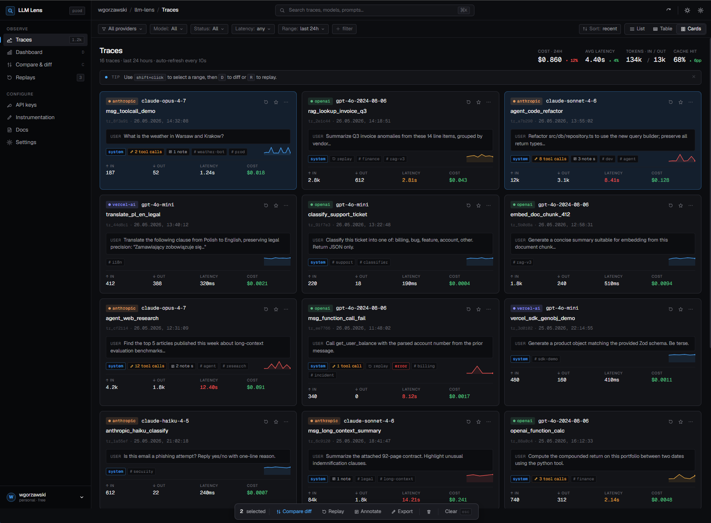
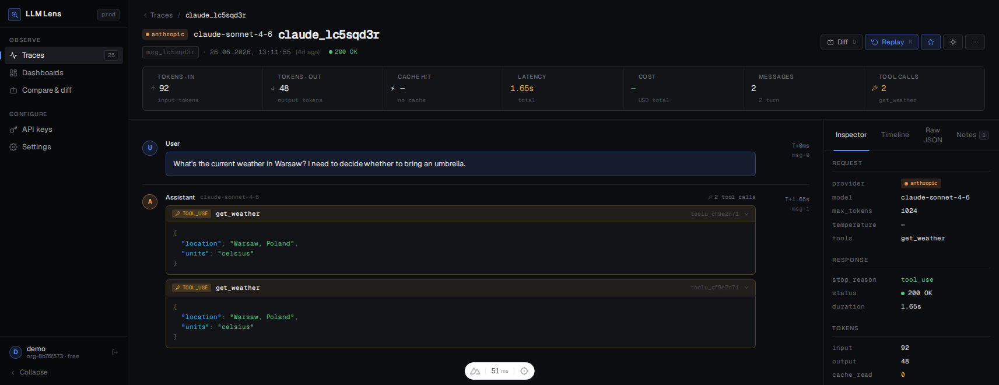
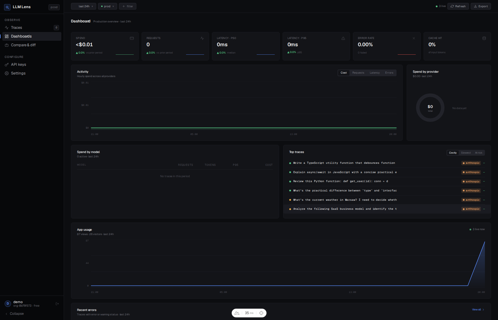
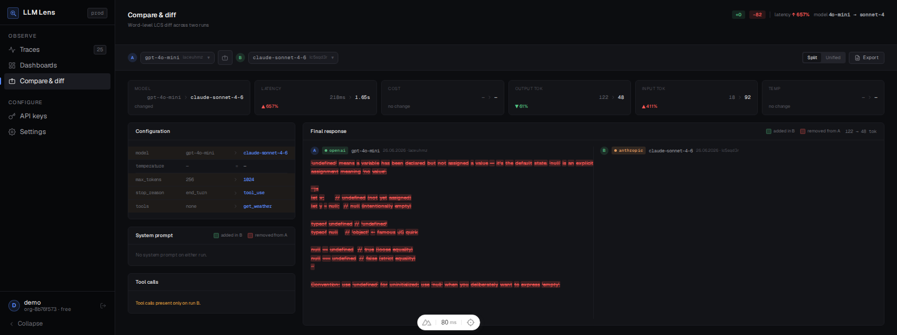

# LLM Lens

[](https://github.com/wgorzawski/llm-lens/actions/workflows/ci.yml)

Self-hosted observability for LLM calls: every prompt, response, error, token and dollar your app spends, in one place. Supports 15 providers (OpenAI, Anthropic, Groq, Gemini, Mistral, DeepSeek, xAI, OpenRouter, Ollama and more) and normalizes them into a unified format for inspection, search, diffing and alerting.

**[→ llm-lens landing page](https://wgorzawski.github.io/llm-lens/)** · **[→ Live demo](https://llmlens.tojest.dev/)**

## Screenshots

### Trace list


### Trace detail


### Dashboard


### Compare & diff


## Features

- **15 providers, one format** — OpenAI, Anthropic, Vercel AI SDK and every OpenAI-compatible API (Groq, Gemini, Mistral, DeepSeek, xAI, OpenRouter, Together, Fireworks, Perplexity, Cerebras, Ollama, Azure OpenAI) normalized to a single `UnifiedTrace` schema
- **Errors, not just successes** — rate limits, 4xx/5xx and timeouts are recorded with status, provider error code and the failing request
- **Names, tags, environments, sessions** — label calls by feature (`recipe.generate`), split production from staging, open a whole chat conversation at once; filter by any of them
- **Cost tracking** — current prices for all major models including cached-token rates; custom prices for anything else (`PRICING_FILE`)
- **Alerts & digests** — error-rate, p95 latency and daily cost alerts to e-mail, Slack, PagerDuty or a webhook; daily and weekly e-mail summaries
- **PII masking** — e-mails, phone and card numbers masked in the SDK before sending, or on the server before storing
- **Self-hosting** — Docker image + compose file, SQLite with nightly backups, invite-only sign-ups, keep-forever retention
- **Chat-style visualization** — role-aware message bubbles (user / assistant / tool)
- **Tool call inspection** — collapsible blocks showing tool name, JSON input, and results
- **System prompt viewer** — collapsible, shown once at the top of the thread
- **Usage stats** — input/output tokens, cache hits (⚡), and latency per trace
- **Provider filter + pagination** — filter by provider, navigate large trace sets
- **Raw JSON access** — full original log available at the bottom of every detail page
- **REST API** — ingest traces programmatically from any language or SDK
- **Auto-instrumentation** — `@llm-lens/instrument` patches your OpenAI or Anthropic client in-place; every call is captured with zero changes to your application logic
- **App usage analytics** — built-in pageview and live-session tracking on the dashboard, no third-party analytics service required

## Tech stack

| Layer | Technology |
|---|---|
| Frontend | Nuxt 4, Vue 3, UnoCSS |
| Backend | Fastify 5, fastify-decorators |
| Database | SQLite via Drizzle ORM + `@libsql/client` |
| Parsers | Pure TypeScript, zero runtime deps |
| Tests | Vitest (parsers, pricing, PII, instrument) + Playwright e2e |
| Monorepo | pnpm workspaces |

## Project structure

```
llm-lens/
├── apps/
│   ├── api/                    # Fastify REST API (port 3001)
│   │   └── src/
│   │       ├── controllers/    # Route handlers with @Controller decorators
│   │       └── db/             # Drizzle schema, client, repository
│   ├── web/                    # Nuxt 4 frontend (port 3000)
│   │   └── app/
│   │       ├── components/     # ProviderBadge, MessageBubble, ToolCallBlock, …
│   │       ├── composables/    # useTraces, useTrace
│   │       └── pages/          # / (list), /traces/[id] (detail)
│   └── playground/             # Vite + Vue demo client (port 5173)
└── packages/
    ├── types/                  # @llm-lens/types — UnifiedTrace + provider schemas
    ├── parsers/                # @llm-lens/parsers — parseAnthropicLog, parseOpenAILog, parseVercelAILog
    └── instrument/             # @llm-lens/instrument — auto-instrumentation wrappers (OpenAI, Anthropic)
```

## Self-hosting

### Docker (recommended)

```bash
git clone https://github.com/wgorzawski/llm-lens.git && cd llm-lens
cp .env.docker.example .env     # set JWT_SECRET (openssl rand -hex 32) and your URLs
docker compose up -d
```

Open [http://localhost:3000](http://localhost:3000) and create the first account - it becomes the owner. With `REGISTRATION_ENABLED=false` nobody else can sign up unless invited (Settings → Members). Data (SQLite database, uploads, daily backups) lives in the `llmlens-data` volume.

Behind a reverse proxy (Caddy, nginx, Traefik, Cloudflare), serve the web app and the API on two hostnames and set `PUBLIC_API_URL`, `API_URL`, `FRONTEND_URL` and `CORS_ORIGINS` in `.env` accordingly.

### Production checklist

| Setting | Why |
|---|---|
| `JWT_SECRET` | random, at least 32 characters; changing it signs everyone out |
| `REGISTRATION_ENABLED=false` (API) + `NUXT_PUBLIC_REGISTRATION_ENABLED=false` (web) | invite-only after the owner account |
| `DEFAULT_RETENTION_DAYS=0` | keep traces forever (each org can change it in Settings → Data retention) |
| `BACKUP_DIR`, `BACKUP_KEEP_DAYS` | daily consistent SQLite snapshot (`VACUUM INTO`) and how many to keep; copy them off the server too |
| `CORS_ORIGINS` | the web app's URL |
| `SMTP_*` | e-mail for alerts, digests and sign-in notifications |
| `PRICING_FILE` | prices for fine-tunes / self-hosted models |
| one API key per app and environment, scope `write` only | a leaked key can only add traces |

### Without Docker

Build with `pnpm -r build` and run `node apps/api/dist/index.js` and `node apps/web/.output/server/index.mjs` under a process manager. `ecosystem.config.cjs` + `deploy.sh` show a PM2 setup running several instances (e.g. a public demo and a production instance) side by side on one small VPS.

## Running from source

### Prerequisites

- Node.js ≥ 24
- pnpm ≥ 11

### Install

```bash
git clone https://github.com/wgorzawski/llm-lens.git
cd llm-lens
pnpm install
```

### Build shared packages

```bash
pnpm --filter @llm-lens/types build
pnpm --filter @llm-lens/parsers build
pnpm --filter @llm-lens/instrument build
```

### Configure environment

```bash
cp apps/api/.env.example apps/api/.env
```

Edit `apps/api/.env` and set at minimum:

```
JWT_SECRET=<any random string, e.g. output of `openssl rand -hex 32`>
```

All other variables have sensible defaults for local development (see `.env.example` for the full list with explanations).

### Run

Start both servers in separate terminals:

```bash
# Terminal 1 — API (port 3001)
pnpm --filter @llm-lens/api dev

# Terminal 2 — Frontend (port 3000)
pnpm --filter @llm-lens/web dev
```

Open [http://localhost:3000](http://localhost:3000).

The SQLite database is created automatically at `./llm-lens.db` on first run.

## Auto-instrumentation

`@llm-lens/instrument` is the easiest way to capture traces from your own code. It patches your provider client in-place so that every API call is forwarded to llm-lens automatically — no changes to your existing call sites, no wrapper functions, no manual logging.

**This is not a connector to ChatGPT, Claude.ai, or any other chat interface.** It captures calls that _your own code_ makes to the provider API. If you have a script, backend, agent, or RAG pipeline that calls OpenAI or Anthropic, wrapping the client is all it takes to see every prompt and response in llm-lens.

### How it works

Each `instrument*` function replaces the relevant `create` method with a thin wrapper. The wrapper:

1. Calls the real provider API and returns the SDK's own promise unchanged - `.withResponse()` and `.asResponse()` keep working
2. Records the wall-clock duration
3. Sends the full request + response to llm-lens in the background (fire-and-forget — your code does not wait for this)
4. Failed calls (rate limits, 4xx/5xx, timeouts) are sent too, as error traces - your code still gets the original error

If the llm-lens server is unreachable the error is swallowed silently, or forwarded to your `onError` handler. Delivery times out after 3 s and at most 100 traces are in flight at once, so a slow llm-lens never piles up memory. Instrumentation never throws and never slows down your application.

### OpenAI

Install the package in your project:

```bash
pnpm add @llm-lens/instrument openai
```

Wrap your client once at startup:

```ts
import OpenAI from "openai";
import { instrumentOpenAI } from "@llm-lens/instrument";

const client = instrumentOpenAI(new OpenAI(), {
  apiUrl: "http://localhost:3001",
  apiKey: "your-api-key",
});

// Every call below is now captured automatically
const response = await client.chat.completions.create({
  model: "gpt-4o",
  messages: [{ role: "user", content: "Hello" }],
});
```

### Groq and other OpenAI-compatible APIs

Most providers speak the OpenAI Chat Completions format - use the OpenAI SDK with their `baseURL` and tell LLM Lens which provider it is, so traces are labelled and priced correctly:

| `provider` | Base URL for the OpenAI SDK | Replay key (server env) |
|---|---|---|
| `groq` | `https://api.groq.com/openai/v1` | `GROQ_API_KEY` |
| `gemini` | `https://generativelanguage.googleapis.com/v1beta/openai` | `GEMINI_API_KEY` |
| `mistral` | `https://api.mistral.ai/v1` | `MISTRAL_API_KEY` |
| `deepseek` | `https://api.deepseek.com/v1` | `DEEPSEEK_API_KEY` |
| `xai` | `https://api.x.ai/v1` | `XAI_API_KEY` |
| `openrouter` | `https://openrouter.ai/api/v1` | `OPENROUTER_API_KEY` |
| `together` | `https://api.together.xyz/v1` | `TOGETHER_API_KEY` |
| `fireworks` | `https://api.fireworks.ai/inference/v1` | `FIREWORKS_API_KEY` |
| `perplexity` | `https://api.perplexity.ai` | `PERPLEXITY_API_KEY` |
| `cerebras` | `https://api.cerebras.ai/v1` | `CEREBRAS_API_KEY` |
| `ollama` | `http://localhost:11434/v1` | - (`OLLAMA_BASE_URL`) |
| `azure-openai` | your deployment URL | `AZURE_OPENAI_API_KEY` + `AZURE_OPENAI_BASE_URL` |

Without the SDK, POST the raw log to `/api/traces/<provider>`.

```ts
const groq = instrumentOpenAI(
  new OpenAI({ apiKey: process.env.GROQ_API_KEY, baseURL: "https://api.groq.com/openai/v1" }),
  { apiUrl: "http://localhost:3001", apiKey: "llmlens_sk_...", provider: "groq" },
);
```

### Naming calls

Give traces a name (shown in the list and filterable as "Feature"), an environment, tags or a session id - statically with `metadata`, or per call with `context`, e.g. from `AsyncLocalStorage`:

```ts
import { AsyncLocalStorage } from "node:async_hooks";
const traceContext = new AsyncLocalStorage<{ name: string; sessionId?: string }>();

instrumentOpenAI(client, { apiUrl, apiKey, metadata: { env: "production" }, context: () => traceContext.getStore() });

await traceContext.run({ name: "recipe.generate" }, () => client.chat.completions.create({ ... }));
```

### Anthropic

```bash
pnpm add @llm-lens/instrument @anthropic-ai/sdk
```

```ts
import Anthropic from "@anthropic-ai/sdk";
import { instrumentAnthropic } from "@llm-lens/instrument";

const client = instrumentAnthropic(new Anthropic(), {
  apiUrl: "http://localhost:3001",
  apiKey: "your-api-key",
});

// Every call below is now captured automatically
const response = await client.messages.create({
  model: "claude-sonnet-4-6",
  max_tokens: 1024,
  messages: [{ role: "user", content: "Hello" }],
});
```

The API key is either a JWT token (copy it from **Settings → API keys** in the UI, or read the `auth_token` cookie from your browser's DevTools after signing in) or a `llmlens_sk_…` key generated in the settings page.

### Options

| Option | Type | Required | Description |
|---|---|---|---|
| `apiUrl` | `string` | yes | llm-lens API base URL, e.g. `http://localhost:3001` |
| `apiKey` | `string` | yes | JWT token or `llmlens_sk_…` API key |
| `provider` | `"openai" \| "groq"` | no | Provider recorded for OpenAI-compatible APIs. Default `"openai"` |
| `enabled` | `boolean` | no | `false` passes every call straight through (kill switch). Default `true` |
| `metadata` | `{ name?, env?, tags?, sessionId?, userId? }` | no | Context sent with every trace |
| `context` | `() => metadata \| undefined` | no | Per-call context, read when the call starts |
| `skip` | `(params) => boolean` | no | Return `true` to not trace a call (e.g. health pings) |
| `maskPII` | `boolean` | no | Replace e-mails, phone and card numbers before sending. Default `false` |
| `redact` | `(text: string) => string` | no | Custom redaction applied to every string sent |
| `timeoutMs` | `number` | no | Delivery timeout. Default `3000` |
| `maxInFlight` | `number` | no | Traces sent at once before new ones are dropped. Default `100` |
| `onError` | `(err: unknown) => void` | no | Called when trace submission fails. Silent by default. |

### Limitations

- **Streaming is not captured.** Calls with `stream: true` are passed through untouched. Collecting a streaming response would require buffering the entire stream before returning it, which would change the timing semantics for your code.
- **Only `chat.completions.create` (OpenAI) and `messages.create` (Anthropic) are patched.** Other endpoints (embeddings, images, etc.) are not affected.
- **Requires Node.js ≥ 18** for the built-in `fetch` used to submit traces.

## Playground

`apps/playground` is a minimal Vite + Vue app that demonstrates end-to-end instrumentation. It simulates an external application that uses llm-lens to observe its LLM calls.

```bash
pnpm --filter @llm-lens/playground dev
# → http://localhost:5173
```

Open **Config**, paste your LLM Lens API key alongside your Anthropic and OpenAI keys (stored in `localStorage`), then type a prompt and click **Send to all providers**. Both providers are called in parallel via their instrumented clients — traces appear in the main llm-lens UI at `http://localhost:3000` immediately.

## API reference

Base URL: `http://localhost:3001/api`

### Ingest a trace

```http
POST /traces/anthropic
POST /traces/openai
POST /traces/vercel-ai
POST /traces/<provider>      # groq, gemini, mistral, deepseek, xai, openrouter, together,
                             # fireworks, perplexity, cerebras, ollama, azure-openai
Content-Type: application/json
```

Body is the raw request + response log for that provider (see [provider schemas](#provider-schemas)). Returns the normalized `UnifiedTrace` with HTTP 201 (409 if a trace with that id already exists).

For OpenAI, Groq and Anthropic a failed call can be sent with `error: { status, message, code }` instead of `response`. Every log can carry an optional `metadata: { name, env, tags, sessionId, userId }`; `env` defaults to the API key's environment.

API keys (`llmlens_sk_…`) can only call the trace endpoints: the `write` scope allows ingest, `read` allows listing and reading traces and stats. Everything else needs a signed-in user.

### List traces

```http
GET /traces?limit=50&offset=0&provider=anthropic
```

| Query param | Type | Default | Description |
|---|---|---|---|
| `limit` | number | `50` | Max results (cap: 200) |
| `offset` | number | `0` | Pagination offset |
| `provider` | string | — | Filter: `anthropic` \| `openai` \| `groq` \| `vercel-ai` |
| `name` | string | — | Filter by trace name (`metadata.name`) |
| `env` | string | — | Filter by environment |
| `sessionId` | string | — | Filter by session |

Response:

```json
{
  "traces": [...],
  "total": 42,
  "limit": 50,
  "offset": 0
}
```

### Get a trace

```http
GET /traces/:id
```

### Delete a trace

```http
DELETE /traces/:id
```

### Filter values

```http
GET /traces/facets
→ { "names": [{ "name": "recipe.generate", "count": 120 }], "envs": [...], "models": [...] }
```

### Health check

```http
GET /health
→ { "status": "ok" }
```

## Provider schemas

### Anthropic

```json
{
  "request": {
    "model": "claude-sonnet-4-6",
    "messages": [{ "role": "user", "content": "Hello" }],
    "system": "You are helpful.",
    "max_tokens": 1024
  },
  "response": {
    "id": "msg_01abc",
    "type": "message",
    "role": "assistant",
    "content": [{ "type": "text", "text": "Hi there!" }],
    "model": "claude-sonnet-4-6",
    "stop_reason": "end_turn",
    "stop_sequence": null,
    "usage": { "input_tokens": 12, "output_tokens": 5 }
  },
  "timestamp": 1715700000000,
  "durationMs": 320
}
```

### OpenAI

```json
{
  "request": {
    "model": "gpt-4o",
    "messages": [
      { "role": "system", "content": "You are helpful." },
      { "role": "user", "content": "Hello" }
    ]
  },
  "response": {
    "id": "chatcmpl-abc",
    "object": "chat.completion",
    "created": 1715700000,
    "model": "gpt-4o-2024-08-06",
    "choices": [{
      "index": 0,
      "message": { "role": "assistant", "content": "Hi there!" },
      "finish_reason": "stop"
    }],
    "usage": { "prompt_tokens": 17, "completion_tokens": 5, "total_tokens": 22 }
  },
  "durationMs": 410
}
```

### Vercel AI SDK

```json
{
  "type": "ai.generateText",
  "operationId": "op-abc",
  "model": "gpt-4o-mini",
  "provider": "openai",
  "timestamp": 1715700000000,
  "durationMs": 190,
  "input": {
    "system": "You are helpful.",
    "messages": [{ "role": "user", "content": "Hello" }]
  },
  "output": {
    "text": "Hi there!",
    "finishReason": "stop"
  },
  "usage": { "promptTokens": 12, "completionTokens": 5, "totalTokens": 17 }
}
```

## Development

### Run tests

```bash
# Unit tests: parsers, pricing and PII masking; the instrument SDK
pnpm --filter @llm-lens/parsers test
pnpm --filter @llm-lens/instrument test

# End-to-end tests (requires running API + web dev servers)
pnpm --filter @llm-lens/e2e test
```

### Add a new provider

An OpenAI-compatible provider only needs an entry in `PROVIDERS` (`packages/types/src/trace.ts`), its prices in `packages/parsers/src/pricing.ts`, its id in the instrument's `OpenAICompatibleProviderId` and a colour in `apps/web/app/assets/css/tokens.css` + `traces.css`. For a provider with its own format:

1. Add raw log types to `packages/types/src/providers/<provider>.ts` and export from `packages/types/src/index.ts`
2. Create `packages/parsers/src/<provider>.ts` implementing `parse<Provider>Log(raw): ParseResult`
3. Export from `packages/parsers/src/index.ts`
4. Add a `POST /traces/<provider>` handler in `apps/api/src/controllers/traces.controller.ts`
5. Add tests in `packages/parsers/src/__tests__/<provider>.test.ts`

### Typecheck all packages

```bash
pnpm typecheck
```

## Contributing

Contributions are welcome. Please open an issue before submitting a PR for non-trivial changes — it helps avoid duplicate work and misaligned direction.

- **Bug fixes** — open a PR directly with a short description of the problem and the fix
- **New features** — open an issue first to discuss scope and approach
- **New provider parsers** — follow the steps in [Add a new provider parser](#add-a-new-provider-parser); include tests
- **Roadmap items** — check the [landing page](https://wgorzawski.github.io/llm-lens/) for planned features before starting

All parser changes must pass `pnpm --filter @llm-lens/parsers test` with no regressions.
